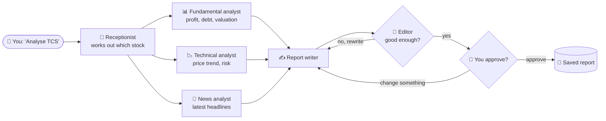

# 📈 AI Stock Research Analyst

**An AI research team that analyses any US or Indian stock, writes a beginner-friendly report, checks its own work, and asks for your approval before finishing.**

Built with **LangGraph** (agent orchestration), **Google Gemini** (LLM), **Yahoo Finance** (live market data) and **LangSmith** (tracing and observability).

---

## 🚀 How to run

**1. Set up the environment** (run from `D:\Education\LangGraph`)
```powershell
python -m venv .venv                     # skip if .venv already exists
.\.venv\Scripts\Activate.ps1
cd stock_research_analyst
pip install -r requirements.txt
```

**2. Add your API keys**
```powershell
copy .env.example .env                   # then open .env and fill in the keys
```
| Key | Get it from |
|---|---|
| `GOOGLE_API_KEY` | [aistudio.google.com/apikey](https://aistudio.google.com/apikey) (free) |
| `LANGSMITH_API_KEY` | [smith.langchain.com](https://smith.langchain.com) → Settings → API Keys |

**3. Run it**
```powershell
python main.py          # start the analyst
python visualize.py     # optional: draws the graph into graph.md
```

**4. Try a conversation**
```text
💬 You: Analyse Apple
   ⚙️ fundamental_analyst: done
   ⚙️ technical_analyst: done
   ⚙️ news_analyst: done
   ⚙️ critic: score=8/10
   ...report is shown...
👤 Type 'approve' or describe changes:  > explain the risks in more detail
   ...report is rewritten...           > approve
✅ Report saved to reports/AAPL_2026-10-13.md

💬 You: Why did you give that verdict?     ← answered from memory
💬 You: Now research Infosys               ← Indian stock (INFY.NS)
```
Commands: `state` shows the saved memory, `new` starts a fresh conversation, `quit` exits.

---

## 💡 What is this project?

Researching a stock properly means reading financial ratios, studying price charts and following the news. For a beginner, that takes hours and a lot of jargon.

This project does that work with a **team of AI specialists**, like a small research firm:



| Step | What happens |
|---|---|
| **Understands you** | "Analyse Reliance", "research tcs" and "what about its competitor?" all work |
| **Researches in parallel** | Three AI analysts work **at the same time** on live data |
| **Writes a report** | Plain-English report with a **BUY / HOLD / AVOID** verdict, reasons and risks |
| **Checks its own work** | An AI editor grades the report and sends weak drafts back for a rewrite |
| **Keeps you in control** | Nothing is final until **you** approve it or ask for changes |
| **Remembers** | Ask follow-up questions about earlier reports in the same conversation |
| **Fully traceable** | Every step, prompt and data fetch can be inspected in LangSmith |

**Markets:** 🇺🇸 US stocks (`AAPL`, `MSFT`…) and 🇮🇳 Indian stocks on NSE/BSE (`TCS.NS`, `RELIANCE.NS`…)

> ⚠️ For learning only. The reports are not financial advice.

---

## 🛠️ Skills demonstrated

| Area | What this project shows |
|---|---|
| **Agent orchestration** | Multi-step AI workflow modelled as a graph with LangGraph |
| **Multi-agent design** | Specialist agents working in parallel, then combined |
| **Tool use** | The LLM decides on its own when to fetch live market data |
| **Self-correction** | A critic-and-rewrite loop that improves output quality |
| **Human-in-the-loop** | The workflow pauses for human approval, then resumes |
| **Memory** | Conversation state persisted with checkpointers and threads |
| **Structured output** | LLM responses forced into typed Pydantic objects |
| **Observability** | End-to-end tracing of every run with LangSmith |
| **Clean architecture** | One concept per file, easy to read and extend |

---

## 🗂️ Project structure

```text
stock_research_analyst/
├── main.py            ▶ run the app (streaming + human review)
├── graph.py           🧩 wires all the steps into one graph
├── state.py           📦 the shared data passed between steps
├── nodes.py           ⚙️ the steps (analysts, writer, critic)
├── edges.py           🔀 decides which step runs next
├── news_subgraph.py   🤖 the news agent that calls tools by itself
├── human_review.py    ⏸️ pauses for your approval
├── memory.py          🧠 remembers the conversation
├── tools.py           🔧 live data from Yahoo Finance
├── schemas.py         📐 typed LLM outputs
├── prompts.py         💬 instructions for the LLM
├── config.py          ⚙️ Gemini + LangSmith setup
├── visualize.py       🖼️ draws the graph
└── notes/             📚 concept notes with diagrams
```

## 📚 Learn the concepts

New to LangGraph? Start with **[notes/README.md](notes/README.md)**. It explains every concept used here in short notes with diagrams.

## 🔧 Troubleshooting

- **`429 / ResourceExhausted`**: Gemini's free-tier rate limit. Wait a minute and try again.
- **BSE (`.BO`) data is thin** on Yahoo Finance. Use NSE (`.NS`) tickers for Indian stocks.
- **No traces in LangSmith**: check `LANGSMITH_TRACING=true` and your key in `.env`.
