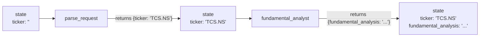
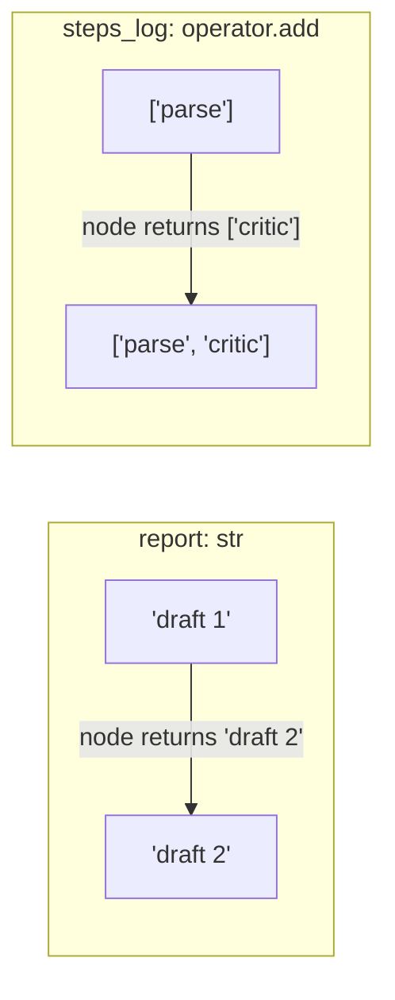

# 1. State & Reducers

## State = the shared notebook

Every step (node) **reads** the state and **returns only the parts it changed**. LangGraph merges those changes in and passes the updated state to the next step.



The shape of the state is declared once with a `TypedDict`, in [state.py](../state.py):

```python
class AgentState(TypedDict, total=False):
    ticker: str
    report: str
    messages: Annotated[list[AnyMessage], add_messages]
    steps_log: Annotated[list[str], operator.add]
```

## Reducers = how updates are merged

| Key declared as | When a node returns a new value… |
|---|---|
| `report: str` (no reducer) | the old value is **overwritten** |
| `Annotated[list, operator.add]` | the new items are **appended** (`old + new`) |
| `Annotated[list, add_messages]` | chat messages are **appended** (or updated by id) |



## Why reducers matter

When **parallel** nodes write to the **same key** at the same time, LangGraph needs a reducer to combine them. Without one, you get an `InvalidUpdateError`. In this project all three analysts append to `steps_log` safely because it uses `operator.add`.

> ✅ **Rule:** a node returns a dict of updates. It never edits `state` directly.
