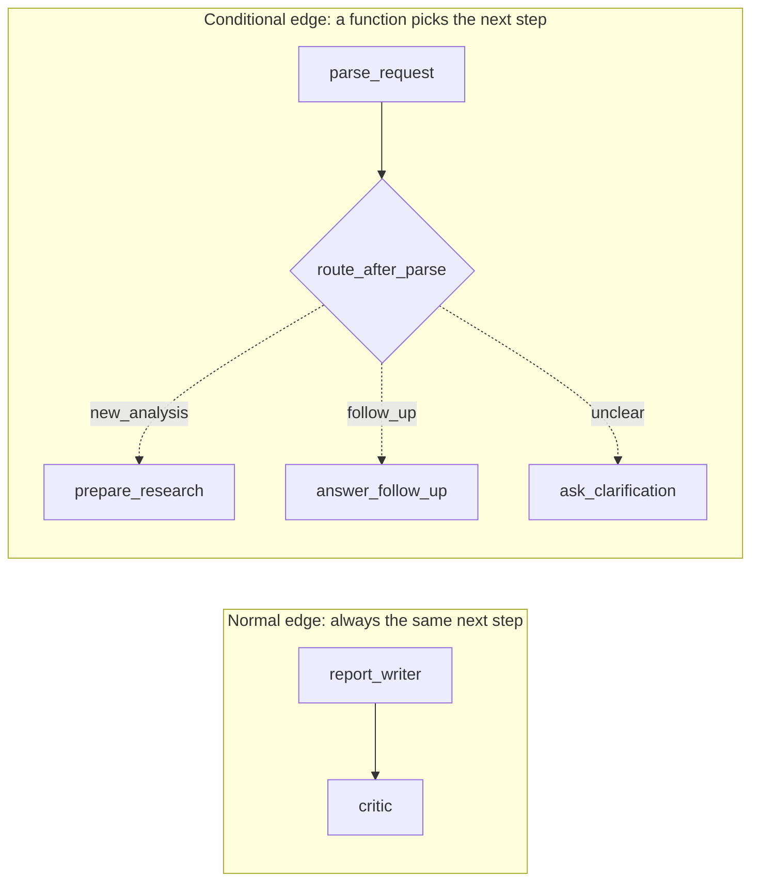
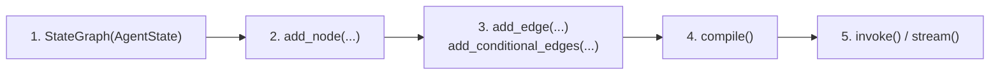

# 2. Nodes & Edges

## Node = a step (just a Python function)

```python
def critic(state: AgentState) -> dict:
    result = grader.invoke(...)                 # do some work
    return {"critic_score": result.score}       # return the updates
```
All the steps are in [nodes.py](../nodes.py).

## Edge = an arrow between steps



```python
builder.add_edge("report_writer", "critic")                       # normal
builder.add_conditional_edges("parse_request", route_after_parse) # conditional
```

A **routing function** reads the state and returns the **name** of the next node. See [edges.py](../edges.py):

```python
def route_after_parse(state) -> Literal["prepare_research", "answer_follow_up", "ask_clarification"]:
    if state["intent"] == "new_analysis":
        return "prepare_research"
    ...
```
The `Literal[...]` return type tells LangGraph every possible destination, so it can draw the graph.

## START and END

Two special built-in nodes: `START` is where the graph begins, and `END` is where it stops.

## The 5-step recipe (in [graph.py](../graph.py))


