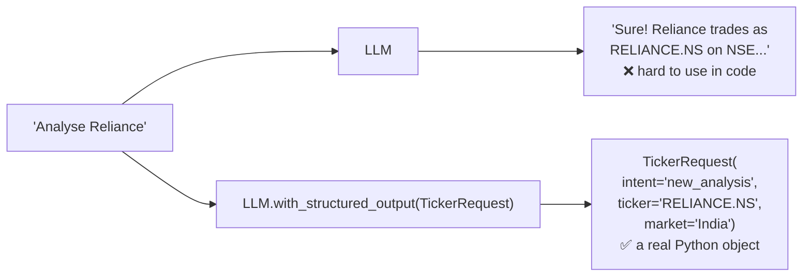

# 3. Structured Output

## The problem

The LLM normally replies with free text, but **routing decisions need exact values**.



## How

1. Describe the shape with a Pydantic model ([schemas.py](../schemas.py)). The `description` text is sent to the LLM as instructions.
2. Wrap the LLM with it.

```python
class CritiqueResult(BaseModel):
    score: int = Field(description="Quality score from 1 to 10.")
    feedback: str = Field(description="Specific suggestions to improve the report.")

result = llm.with_structured_output(CritiqueResult).invoke(prompt)
result.score   # -> 8  (an int, ready to compare in an edge)
```

## Used in this project

| Node | Schema | Drives which decision? |
|---|---|---|
| `parse_request` | `TickerRequest` | Which path to take (`route_after_parse`) |
| `critic` | `CritiqueResult` | Rewrite or move on (`route_after_critic`) |

> 💡 Structured output + conditional edges = **the LLM makes the decision, your graph enforces it.**
