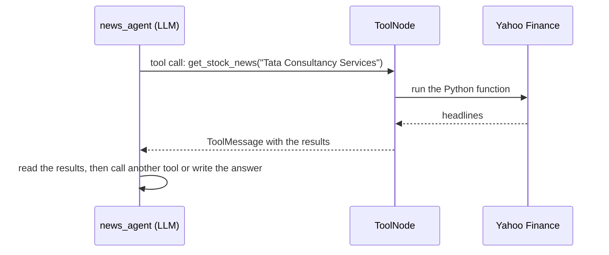
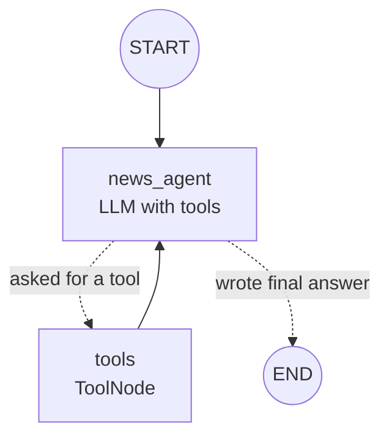

# 4. Tools & the Agent Loop

## Tool = a Python function the LLM is allowed to call

An LLM can't look up today's stock price, but it can **ask** us to run a function that does.

```python
@tool
def get_stock_news(query: str) -> str:
    """Search the latest news headlines about a company."""   # ← the LLM reads this!
    ...
```
The **name, arguments and docstring** tell the LLM what the tool does and when to use it. See [tools.py](../tools.py).

## How a tool call happens



## The agent loop (in [news_subgraph.py](../news_subgraph.py))



| Piece | Job |
|---|---|
| `llm.bind_tools([...])` | Tells the LLM which tools exist |
| `ToolNode(tools)` | Prebuilt node that **runs** the requested tools |
| `tools_condition` | Prebuilt router: go to `"tools"` if the LLM asked for one, otherwise `END` |

The loop lets the agent **retry**. If searching `TCS.NS` finds no news, it can try `"Tata Consultancy Services"` next.

## Two ways to use tools

| Who calls the tool? | Where | When to use it |
|---|---|---|
| **The LLM decides** (agent) | `news_analyst` | The steps aren't known in advance |
| **Your code calls it** `tool.invoke({...})` | `fundamental_analyst`, `technical_analyst` | You always need the same data |
