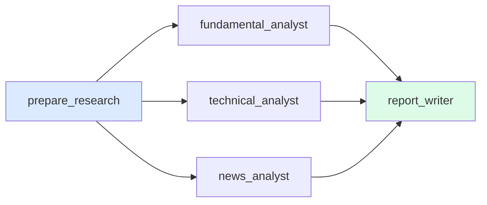

# 5. Parallel Execution (Fan-out / Fan-in)

The three analysts don't depend on each other, so they run **at the same time**.

| Pattern | Code in [graph.py](../graph.py) | Meaning |
|---|---|---|
| **Fan-out** | several `add_edge("prepare_research", X)` | Start all the targets together |
| **Fan-in** | `add_edge([F, T, N], "report_writer")` | Wait for **all** of them, then continue |

## Super-steps: how LangGraph runs it

```mermaid
gantt
    dateFormat X
    axisFormat %s
    section Step 1
    parse_request        :0, 1
    section Step 2
    prepare_research     :1, 2
    section Step 3 (parallel)
    fundamental_analyst  :2, 3
    technical_analyst    :2, 3
    news_analyst         :2, 3
    section Step 4
    report_writer        :3, 4
```

Nodes in the same super-step run together. The state is only merged **after the whole super-step finishes**.

> ⚠️ **Gotcha:** parallel nodes writing to the **same key** need a reducer (see [note 1](01_state_and_reducers.md)). Here each analyst writes its own key (`fundamental_analysis`, `technical_analysis`, `news_analysis`), so there's no clash.

> 🚀 **Next level:** when the number of branches is only known at runtime (e.g. "compare TCS, INFY and WIPRO"), use the `Send` API to create one branch per item.
