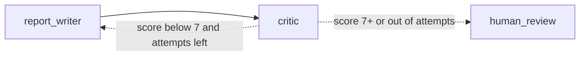
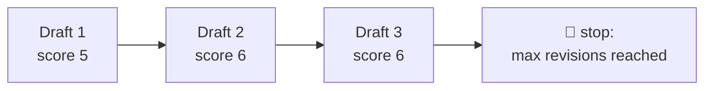

# 6. Loops (Self-Correction)

A loop is simply an edge that points **backwards**. Here the critic can send the report back to the writer.



```python
def route_after_critic(state) -> Literal["report_writer", "human_review"]:
    good_enough     = state["critic_score"] >= MIN_QUALITY_SCORE
    out_of_attempts = state["revision_count"] > MAX_REVISIONS
    if good_enough or out_of_attempts:
        return "human_review"
    return "report_writer"
```
See [edges.py](../edges.py). The writer adds 1 to `revision_count` on every draft.

## Every loop needs an exit



| Safety net | Where |
|---|---|
| **Your own counter** (`MAX_REVISIONS`) | [config.py](../config.py) |
| **LangGraph's `recursion_limit`** (default 25 steps) | Raises `GraphRecursionError` if a graph runs too long |

> 💡 This *generate → evaluate → improve* pattern is often called **reflection**. It's one of the most common ways to improve LLM output quality.
