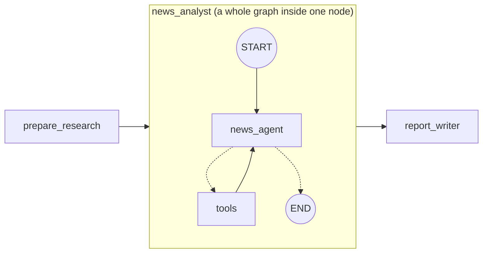
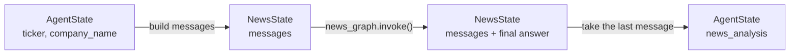

# 7. Subgraphs

A **compiled graph can be used as a step inside another graph**, like calling a function.



## Why use one?

- **Organise:** each piece is small and can be tested on its own.
- **Private state:** the news agent's many tool messages stay **inside** the subgraph and don't clutter the main conversation.

## Different state = translate in and out

The subgraph uses `NewsState` (just `messages`), but the main graph uses `AgentState`. A wrapper node converts between them ([news_subgraph.py](../news_subgraph.py)):



```python
def news_analyst_node(state: AgentState) -> dict:
    result = news_graph.invoke({"messages": [SystemMessage(...), HumanMessage(...)]})
    return {"news_analysis": result["messages"][-1].text}
```

| Situation | How to add the subgraph |
|---|---|
| Same state keys as the parent | `builder.add_node("news", news_graph)` directly |
| Different state (our case) | Call it inside a wrapper node, as above |
