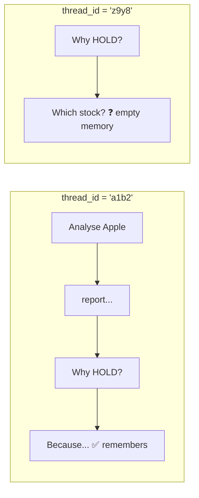
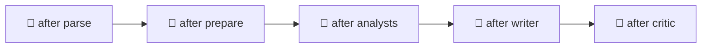

# 8. Memory (Checkpointer)

Without memory, every run starts with an empty state. A **checkpointer** saves the state after every step, and a **`thread_id`** says which conversation to load.

```python
graph  = builder.compile(checkpointer=MemorySaver())      # memory.py / graph.py
config = {"configurable": {"thread_id": "a1b2c3"}}         # main.py
graph.invoke({"messages": [HumanMessage("Analyse Apple")]}, config)
```

## Threads = separate conversations



## Checkpoints = snapshots after every step



| Method | What it gives you |
|---|---|
| `graph.get_state(config)` | The latest saved state (used by the `state` command) |
| `graph.get_state_history(config)` | Every snapshot ("time travel") |

## Things memory makes possible here

- Follow-up questions: *"Why did you give that verdict?"*
- **Pausing** for human review ([note 9](09_human_in_the_loop.md)), because a paused graph must be saved somewhere.

> ⚠️ **Gotcha:** old values stay in memory! That's why `prepare_research` resets `report`, `revision_count`, etc. before each new analysis.

| Checkpointer | Stored in | Use for |
|---|---|---|
| `MemorySaver` | RAM (lost on exit) | Learning (this project) |
| `SqliteSaver` | `.db` file | Small apps |
| `PostgresSaver` | Database | Production |
