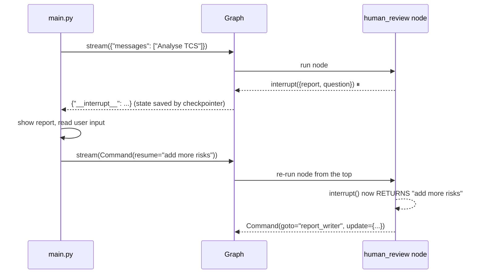
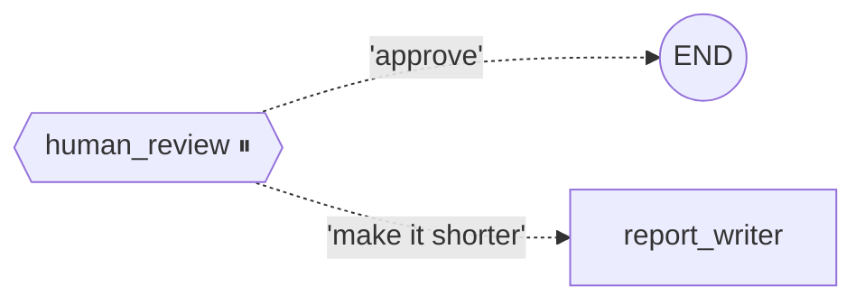

# 9. Human-in-the-Loop

Sometimes a person must check the AI's work before it's final. LangGraph can **pause** a graph, wait for a human, then **resume** from exactly that point.

## The pause–resume cycle



## The two tools

| Tool | Job |
|---|---|
| `interrupt(value)` | Pause the graph and send `value` to the app |
| `Command(resume=answer)` | Resume the graph. `answer` becomes the return value of `interrupt()` |

## `Command(goto=...)`: routing from inside a node

Instead of a separate routing function, the node itself picks the next step **and** updates the state in one go ([human_review.py](../human_review.py)):



```python
answer = interrupt({"report": state["report"], "question": "Approve or change?"})
if answer == "approve":
    return Command(goto=END, update={"messages": [AIMessage(state["report"])]})
return Command(goto="report_writer", update={"human_feedback": answer})
```

> ⚠️ **Gotchas**
> - Interrupts **require a checkpointer** (the paused state has to be saved somewhere).
> - On resume the node **restarts from the top**, so don't put side effects (saving files, sending emails) **before** `interrupt()`.
