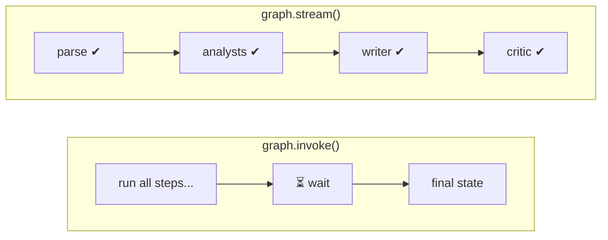

# 10. Streaming



`invoke` gives you **only the end result**. `stream` gives you **an update after each step**, which is how `main.py` prints the live `⚙️` progress lines.

```python
for chunk in graph.stream(graph_input, config, stream_mode="updates"):
    for node_name, update in chunk.items():
        if node_name == "__interrupt__":     # the graph paused for a human
            ...
        print(node_name, update.get("steps_log"))
```

## Stream modes

| `stream_mode` | Each chunk contains | Good for |
|---|---|---|
| `"updates"` (used here) | `{node_name: what that node returned}` | Progress logs |
| `"values"` | The **full state** after each step | Debugging |
| `"messages"` | LLM output **token by token** | Chat-style "typing" effect |

> 💡 You can pass a list, e.g. `stream_mode=["updates", "messages"]`, to get several kinds at once.
