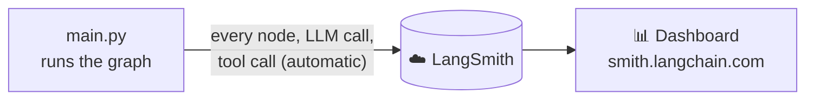
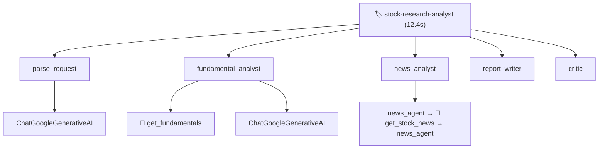

# 11. LangSmith Tracing

AI apps are hard to debug: *which step failed? What prompt did the LLM actually get?* **LangSmith records every run** so you can see everything in a web dashboard.

## Setup: just environment variables

No tracing code is needed in the graph. LangChain and LangGraph detect these settings in `.env` automatically:

```env
LANGSMITH_TRACING=true
LANGSMITH_API_KEY=lsv2_...
LANGSMITH_PROJECT=stock-research-analyst
```



## What one trace looks like


Click any box to see its **input, output, duration, tokens and errors**.

## Labelling runs (in [main.py](../main.py))

```python
config = {
    "configurable": {"thread_id": thread_id},
    "run_name": "stock-research-analyst",    # name shown in the dashboard
    "tags": ["learning", "stock-analyst"],   # filter runs by tag
    "metadata": {"thread_id": thread_id},    # extra searchable info
}
```

## What to look for

- ⏱️ **Parallel analysts** start at the same time.
- 🔁 **Critic loop**: count how many `report_writer` runs happened.
- 🔧 **Tool calls**: what query did the news agent actually search?
- 💬 **Prompts**: the exact text sent to Gemini (great for improving prompts).
