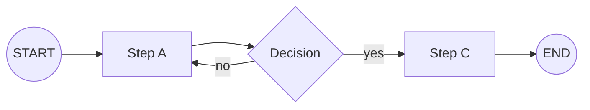
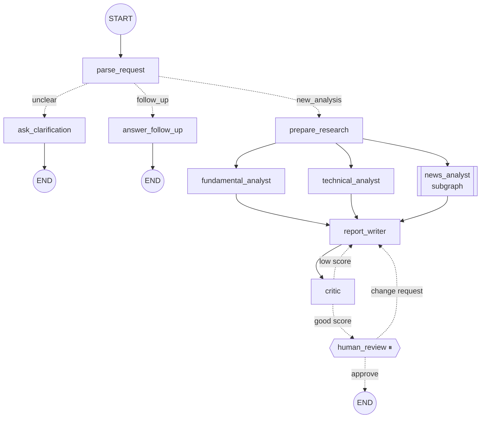

# 📚 LangGraph Notes

Short notes on every LangGraph concept used in this project. Each note covers **what it is**, gives **a diagram**, and shows **where it is in the code**.

> 💡 The diagrams use **Mermaid**. They render automatically on GitHub. In VS Code, install the
> *Markdown Preview Mermaid Support* extension, then press `Ctrl+Shift+V`.

## What is LangGraph, in one line?

> **LangGraph lets you build an AI app as a flowchart.** Each box is a step, the arrows decide what runs next, and a shared notebook (the *state*) carries the data along.

Plain LLM calls can only go in a straight line. LangGraph adds **branches, loops, parallel steps, memory and pauses**, which real AI agents need.

## Reading order

| # | Note | You'll learn |
|---|---|---|
| 1 | [State & Reducers](01_state_and_reducers.md) | The shared data and how updates are merged |
| 2 | [Nodes & Edges](02_nodes_and_edges.md) | Steps, arrows, `START`/`END`, branching |
| 3 | [Structured Output](03_structured_output.md) | Getting typed data instead of free text from the LLM |
| 4 | [Tools & the Agent Loop](04_tools_and_agent_loop.md) | Letting the LLM fetch real data by itself |
| 5 | [Parallel Execution](05_parallel_execution.md) | Running steps at the same time (fan-out / fan-in) |
| 6 | [Loops](06_loops.md) | Self-correction cycles and how to exit them |
| 7 | [Subgraphs](07_subgraphs.md) | A graph inside a graph |
| 8 | [Memory (Checkpointer)](08_memory.md) | Remembering conversations with `thread_id` |
| 9 | [Human-in-the-Loop](09_human_in_the_loop.md) | Pausing for approval with `interrupt` and `Command` |
| 10 | [Streaming](10_streaming.md) | Watching each step live |
| 11 | [LangSmith Tracing](11_langsmith_tracing.md) | Seeing inside every run |

## The full project graph

Solid arrows are **normal edges**. Dotted arrows are **conditional** (decided at runtime).
